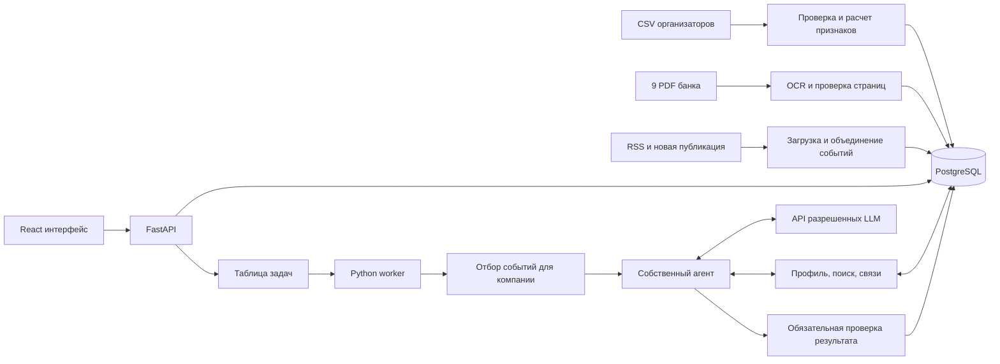

# Архитектура Alphich

Alphich помогает руководителю понять, как событие связано с его компанией, какие последствия возможны и какие данные нужно уточнить. Основной результат — карточка события с доказательствами, датированной позицией банка и отдельно обозначенной интерпретацией AI.

Проект рассчитан на 72 часа и команду от пяти человек. Техническое решение — модульный Python backend, один собственный агент, PostgreSQL и React. Первым собираем полный рабочий сценарий, затем улучшаем качество и интерфейс.

## Пользовательский сценарий

1. Пользователь открывает демонстрационный интернет-банк, выбирает разрешенную компанию и роль: финансовый или генеральный директор.
2. На главной постоянно доступен блок аналитики с тремя значимыми событиями и переходом в полную ленту.
3. Лента объясняет, почему событие попало в подборку: отрасль, банковский продукт, страна или известная платежная связь.
4. Карточка последовательно показывает событие, связь с компанией, позицию банка, вывод AI, риски, возможности и следующий вопрос или действие.
5. Пользователь открывает подтверждающий фрагмент источника и задает уточняющий вопрос в контексте карточки.

Выбор компании и роли в демо заменяет банковскую интеграцию. Он не означает возможность произвольно читать профили через API: сервер проверяет доступ пользователя к компании. В исходных данных нет пользовательских ролей; роли задаются отдельным демонстрационным профилем.

## Компоненты

| Компонент | Решение | Причина |
| --- | --- | --- |
| Интерфейс | React, TypeScript, Vite | Быстрый интерактивный интерфейс; серверный рендеринг для демо не требуется |
| API и схемы | Python, FastAPI, Pydantic | Одна среда для ETL, поиска, агента и валидации |
| Данные | PostgreSQL и pgvector | Профили, связи, текстовый/векторный поиск, задачи, кэш и журнал в одной системе |
| Эмбеддинги | Локальный multilingual-e5-base | Смысловые кандидаты для новостей и фрагментов банка; отдельный пакетный worker |
| Долгие операции | Отдельный worker из того же Python пакета | Генерация и загрузка не удерживают HTTP запрос |
| PDF | Poppler и Tesseract с русским и английским языками | Все 64 страницы предоставленного корпуса без текстового слоя |
| LLM | Собственный HTTP адаптер к выданному API | Модели и протокол определяются реальным шлюзом организаторов |
| Запуск | Docker Compose: frontend, api, worker, postgres | Один воспроизводимый запуск на ноутбуке и сервере |

Для недельного стенда выбран Cloud.ru Evolution за счет стартового гранта: ВМ 4 vCPU / 16 GB, 40 GB SSD и один IP. Получение гранта и полный estimate проверяются до создания ресурсов; при отказе резервом служит локальный Compose с публичным tunnel. Расчет и завершение размещения описаны в [плане хостинга](hosting.md).

Совместимые версии языка, библиотек и образов фиксируются при первом рабочем запуске в lock-файлах и конфигурации. Официальные основы: [Vite](https://vite.dev/guide/), [FastAPI в Docker](https://fastapi.tiangolo.com/deployment/docker/), [PostgreSQL FTS](https://www.postgresql.org/docs/current/textsearch.html), [языки Tesseract](https://tesseract-ocr.github.io/tessdoc/Data-Files-in-different-versions.html).

## Подготовка компаний

Импорт воспроизводим и сохраняет исходные строки отдельно от нормализованных таблиц. Профилируем весь набор до генерации выводов.

- `SYNTHETIC_U`, ОКВЭД и идентификаторы храним строками; флаги вида `1.0` нормализуем в bool.
- Один ID с 12 конфликтующими профилями отправляем в карантин. Не выбираем первую строку молча.
- Пустое значение сохраняем как неизвестное. Конфликт `FTS_FLAG` и списка стран отмечаем как проблему данных.
- Сохраняем неизвестные узлы платежного графа, но оставляем их отрасль и другие атрибуты неизвестными.
- Для характеристик контрагентов исключаем `PAYER == BENEFICIARY`; эти строки сохраняются в сыром слое.
- Для 17 повторов направленной пары фиксируем демо-политику: точное совпадение строки учитываем один раз, остальные агрегируем с флагом неоднозначности. Без периода и ID операции совпадение не доказывает ошибочный дубль; сырые строки сохраняем и правило можно пересчитать. Суммы по затронутым парам не интерпретируем как достоверный оборот без пояснения организаторов.
- Для контрагентных и групповых признаков отдельно считаем внутренние и внешние потоки. Выручку участников группы не называем консолидированной выручкой.

`company_features` хранит готовые признаки: отрасль, регион регистрации, продукты, страны ФТС, состав группы, крупнейшие платежные связи, концентрацию и долю потока с известными профилями контрагентов. У каждого признака есть `feature_id`, правило расчета, версия и основание.

Индексы по `PAYER`, `BENEFICIARY`, `GROUP_ID` и `SYNTHETIC_F` позволяют работать с прямыми связями без отдельной графовой БД. Не строим автоматический граф отношений из каждого слова PDF. Для ранжирования используем один переход по известной платежной связи и ограничиваем его вклад.

Границы выводов: регион регистрации не доказывает географию всех операций; ФТС не определяет импорт/экспорт и валюту; наличие кредита не раскрывает сумму, ставку и срок; связь по физлицу не доказывает владение. Период и денежные единицы платежного среза отсутствуют. Долю рынка и динамику платежей из этого набора получить нельзя.

## Подготовка аналитики банка

1. Скачать файлы по манифесту, сохранить контрольную сумму и идентификатор источника.
2. Отрендерить страницы, выполнить OCR один раз и сохранить результат. Проверить вручную даты, ключевые числа и фрагменты, попадающие в демо.
3. Разделить текст по смысловым абзацам в пределах страницы; сохранить заголовок, тему, страницу, исходный текст и при наличии координаты фрагмента.
4. Раздельно записать дату публикации, период статистики, горизонт прогноза и время загрузки.
5. Индексировать текст и метаданные: PostgreSQL FTS с русской конфигурацией и локальные E5 embeddings в pgvector, объединение рангов через RRF. Trigram полезен для имен и опечаток. FTS остается измеряемым baseline и режимом при недоступном кодировщике.

Изначальные темы: ставка и финансирование; инфляция и издержки; потребление и спрос; сырье; внешняя торговля. Для ОКВЭД задаем небольшой явный справочник отраслей. Агент может переформулировать запрос разрешенной LLM и повторить поиск.

Пользователь подтвердил допустимость локальных embedding-моделей 20 октября 2026 года; ограничение списка относится к генеративным LLM. Базовый вариант — локальный multilingual-e5-base и точный поиск pgvector без отдельной векторной БД. Правила кодирования, версии и оценка приведены в [проекте поиска](retrieval.md).

## Новости и события

Первый источник — [RSS пресс-релизов ЦБ](https://cbr.ru/rss/RssPress). Второй — [RSS Интерфакса](https://www.interfax.ru/rss.asp), где сначала отбираем экономические темы. На момент проверки обе ленты отдавали XML; это еще не проверка стабильности получения полного текста статей. Если доступен только анонс, маркируем полноту и ограничиваем анализ.

Планировщик опрашивает ленты с настраиваемым интервалом, сохраняет полученные публикации и не рассчитывает получить всю историю из короткой RSS выдачи. Для нового материала обязательно работает вставка текста; загрузка по URL — дополнительный путь с теми же проверками источника.

Загрузка: источник → нормализация URL и текста → content hash → поиск дубликатов → извлечение фактов → событие. Одна публикация может описывать несколько событий; несколько публикаций — одно событие. В P0 поддерживаем один главный сюжет публикации и сохраняем исходники, не сливаем разные решения регулятора только по похожему заголовку.

Локальный поиск сначала выделяет перспективные публикации и общие важные события. LLM извлекает темы, сущности, даты и факты в строгую схему один раз на версию публикации. Схожие материалы объединяем по теме, участникам и времени с сохранением всех источников; embedding сходство только предлагает кандидатов. Спорные совпадения оставляем раздельно. Поступление новой версии факта инвалидирует связанные результаты.

## Персонализация

Из подтвержденных признаков создаем несколько коротких запросов по отрасли, финансированию, внешней торговле и известным связям. Для каждого объединяем текстовый и смысловой поиск, а между запросами ограничиваем накопление веса. Отдельные каналы сохраняют структурные совпадения и значимые общие события. Ранжирование учитывает роль, свежесть, применимость и разнообразие ленты; хранит matched feature/fact IDs и причины. Наличие банковского PDF не является фильтром релевантности новости.

Начальные веса — эвристика, которую корректируем по размеченным примерам. Кредитный признак повышает интерес к стоимости финансирования; он не доказывает величину риска. Неизвестные данные снижают уверенность в выводе, но не должны автоматически скрывать потенциально важное событие. Значимость и достаточность доказательств показываются отдельно.

Извлечение фактов общее для всех клиентов. Подробные интерпретации генерируются для выбранной компании и первых 3–5 событий, затем кэшируются. Не генерируем произведение всех компаний на все новости.

## Собственный агент

Реализация runtime, настройки, действующие API и текущие ограничения описаны в [инструкции LLM](llm.md). Шлюз пока не предоставлен, поэтому сквозные тесты используют явно тестовые ответы. Ниже сохранена целевая архитектура; например, текущий предел — восемь model calls с учётом extraction и проверок, а не первоначальная оценка в четыре.

Профиль, основные признаки, роль, выбранное событие и список доступных источников загружаются в начальное состояние обычным кодом. LLM определяет, какие дополнительные сведения нужны, выбирает разрешенное действие и получает структурированный результат инструмента.

Инструменты: `search_bank_materials`, `search_related_events`, `get_company_features`, `get_payment_neighbors`, `get_evidence`. Они возвращают ограниченный объем данных и только те записи, которые доступны пользователю. Runtime принимает JSON action и проверяет его Pydantic схемой; нативный tool calling не является обязательным условием.

Пример реальной адаптации: поиск находит старый обзор ставки; агент видит дату и повторяет поиск по более свежему прогнозу. После получения новых свидетельств меняет оценку или явно отмечает недостаток информации. Если запрос повторяется без новых результатов, runtime завершает поиск с ограниченным выводом.

Начальные ограничения на одну задачу: до 4 обращений к модели, до 8 вызовов инструментов, до 1 попытки исправить черновик. Эти лимиты, максимальный контекст, токены ответа и таймаут конфигурируются после первых измерений. Повторный поиск и исправление входят в общий бюджет, а не запускаются сверх него.

Для UI сохраняем краткий план действий, вызовы, ссылки на полученные свидетельства и результаты проверок. Подробные внутренние рассуждения модели для трассировки не требуются.

## Проверка и происхождение выводов

Сервер всегда выполняет проверку перед публикацией, даже если агент считает работу завершенной. Проверяем JSON, существование и доступность `evidence_id`, даты, принадлежность признаков выбранной компании, числа и обязательное разделение типов утверждений. Проверка охватывает все содержательные поля, включая заголовок, риски, возможности и основания предлагаемых действий.

Каждый существенный тезис относится к одному из типов: `news_fact`, `company_fact`, `bank_view`, `model_inference`. Для вывода модели храним фактические предпосылки и условия применимости. Банковская позиция требует конкретного материала, страницы и даты; модель не создает URL самостоятельно.

Совпадение ID не доказывает смысловую поддержку тезиса. Проверяем подтверждающие выдержки на контрольном наборе и используем проверку моделью в пределах бюджета как дополнительный сигнал. Неподтвержденный тезис удаляется, исправляется либо получает статус ограничения; результат проверки сохраняется.

## Время и изменение позиции банка

У новости отдельно храним `published_at`, `event_at`, `fetched_at`; у обзора — дату публикации и горизонт прогноза. Дата создания PDF и загрузка на Drive не заменяют дату внутри документа.

В режиме текущей ленты старый обзор может объяснять механизм влияния, но не представляется текущим прогнозом. Выбираем последнюю найденную применимую позицию в загруженном корпусе, не заявляя полноту всех публикаций банка. Сопоставляем показатель, горизонт, сценарий и роль утверждения: даже новый обзор может цитировать прежний прогноз. При обновлении прежняя позиция остается в истории; неразрешенный конфликт показываем с датами и различиями.

Исторический режим ограничивает источники датой `as_of`. Материал без надежно установленной даты публикации исключаем из строгого исторического анализа. CSV не имеет даты снимка: его используем как учебный профиль, не утверждаем достоверность состояния компании на историческую дату. Историческое воспроизведение касается известных к тому моменту новостей и обзоров.

Сильный демонстрационный пример: обзор от 31.07.2026 ожидает ставку 13,5% к концу 2026 года, обзор от 11.09.2026 обновляет ожидание до 14%. Показываем, почему новый вывод использует более свежую оценку, со ссылками на обе страницы.

## Очередь и кэш

API создает идемпотентную задачу, возвращает `202` и `job_id`. Worker атомарно забирает задачу через блокировку строки PostgreSQL, сохраняет статус и heartbeat. Повтор после сбоя ограничен; одинаковая задача не создает вторую параллельную генерацию. UI опрашивает статус, SSE можно добавить после рабочего сценария.

Ключ кэша: компания и версия ее признаков/связей, роль, версия события и новостного набора, дата анализа, версия корпуса банка/OCR, embedding space, шаблоны поиска и ranking, генеративная модель и версия prompt. Для текущей ленты нормализуем дату анализа до выбранного среза и используем TTL; новое событие, новая позиция банка или новый профиль инвалидируют результат.

При недоступности LLM показываем последнюю сохраненную карточку с ее датой. Для новой новости выводим доступные факты и статус незавершенного анализа; это не подменяется заранее записанной генерацией. Демо на синтетических данных явно обозначается.

## Бюджет моделей

Для генеративных задач используем только модели из приложения 3 кейса. Локальные embedding-модели разрешены отдельно и не используют ключ генеративного шлюза. В конфигурации фиксируем допустимые generative model ID и назначение: extraction, analysis, при необходимости vision. Выбираем их по небольшому сравнению качества, времени, стоимости и соблюдения JSON на реальном API. Наличие SDK совместимого формата не означает, что шлюз поддерживает все его параметры.

Перед каждым вызовом резервируем максимальную стоимость из общего дневного лимита 500 рублей по подтвержденным тарифам. После ответа сверяем usage. Таймаут мог быть оплачен: не освобождаем резерв автоматически как будто вызова не было. Учитываем все ключи и участников, использующих общий доступ, и оставляем резерв на живую демонстрацию.

OCR, извлечение общего события, поиск, арифметика и кэш уменьшают число генераций. Точный доступный объем запросов станет известен после проверки тарифов и лимитов шлюза; обещания стоимости карточки до измерений не даем.

## Доступ и обработка внешнего текста

Проверка доступа к компании выполняется сервером до чтения профиля, поиска свидетельств и получения карточки. Ключи моделей остаются на сервере. В LLM отправляем только необходимые признаки; физические идентификаторы без нужды не передаем.

Текст новости, PDF и пользовательские вставки — данные. Он не может расширять список инструментов, менять доступ или выдавать команды runtime. У инструментов фиксированные схемы, ограничения объема и журнал вызовов. Произвольный SQL и запуск shell агенту недоступны.

Загрузчик URL проверяет домены, редиректы, тип и размер ответа, блокирует внутренние адреса. HTML очищается, выводы модели отображаются безопасным рендерером. Эти меры являются частью требуемой в кейсе защиты AI компонентов.

## Наблюдение и развитие

Измеряем качество первых пяти событий, поддержку тезисов источниками, атрибуцию банку, ошибки времени, задержки, токены, стоимость и долю неуспешных задач. Пользовательская обратная связь привязывается к компании, событию и версии результата; эксперт может пометить ошибочный факт или нерелевантную связь.

Расширение: новые источники добавляются адаптерами; отрасли — справочниками и контрольными примерами; worker масштабируется отдельно; оригиналы документов можно вынести в объектное хранилище. Смена модели проходит повторный прогон того же контрольного набора. Ответственность за словари, источники, корпус и модели фиксируется в плане сопровождения.

## Объем первого прототипа

P0: три компании целевого масштаба, две роли, 2–3 темы, рабочая загрузка новых материалов, персональная лента, источники, вопрос по карточке, агент с повторным поиском, журнал, бюджет и воспроизводимый запуск.

P1 после полного P0: до пяти компаний, второй источник, прямые платежные связи с показателем охвата, история обновления прогноза банка, сравнение влияния одного события на две компании, обратная связь и простой групповой обзор.

Отдельные микросервисы, автоматический полный knowledge graph, обучение LLM, оценка рыночной доли, реконструкция реальных компаний, платежные действия и сложный финансовый симулятор не входят в 72 часа.
