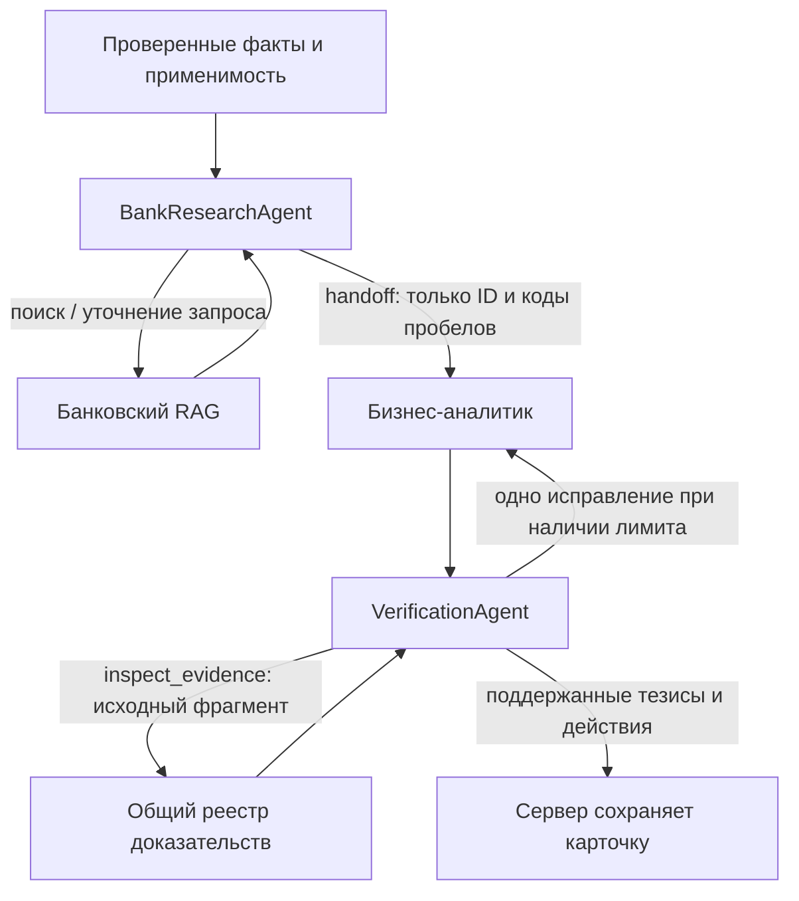

# LLM анализ и подключение к приложению

В `backend/app/intelligence/` реализован путь «событие → извлечение цитируемых фактов → персональный отбор → банковский RAG → собственный агент → проверенная карточка → уточняющий вопрос». API ставит задачи в PostgreSQL; отдельный `analysis-worker` выполняет генеративные вызовы и не задерживает worker загрузки публикаций.

Доступ к шлюзу организаторов подтверждён настоящими вызовами: проверены каталог, chat completions, usage и квитанции стоимости. Адрес и шесть model ID взяты из [инструкции организаторов](https://docs.google.com/document/d/1ly8GsI_-oPnCQWvtZ4nGevnnDP2MGYIfpn2zOUFxZ_4/mobilebasic); публичный каталог находится в [organizer_models.json](../backend/fixtures/organizer_models.json). Командный ключ хранится только локально в игнорируемом `.env`. Генерация проверяется на небольшом открытом наборе; независимой оценки качества пока нет.

## Настройка шлюза

Для Cloud.ru действует [публичный профиль](cloudru-runtime-config.md), переопределяющий совпадающие переменные из серверного `.env`. В текущем профиле `GLM` используется и для извлечения, и для анализа; Qwen остаётся разрешённой моделью в каталоге с `output_limit=4096`. Описанные ниже живые проверки с Qwen относятся к ранее испытанному варианту, а не обязательно к текущему контейнеру.

Скопируйте `.env.example` в `.env`. Заполните серверные переменные после получения доступа:

| Переменная | Значение |
| --- | --- |
| `LLM_BASE_URL` | `https://changellenge.up.railway.app/v1` |
| `LLM_API_KEY` | Секретный ключ, только на сервере |
| `LLM_EXTRACTION_MODEL`, `LLM_ANALYSIS_MODEL` | Реальные model ID шлюза; можно использовать один ID для обоих этапов |
| `LLM_MODEL_CATALOG_JSON` | JSON-массив model ID, семейства, локальных лимитов и параметров из каталога; цены нужны только для режима `token_prices` |
| `LLM_BUDGET_MODE` | `token_prices` или `gateway_receipt`; по умолчанию первый |
| `LLM_PRICES_CONFIRMED` | Для `token_prices`: `1` только после подтверждения входных/выходных тарифов |
| `LLM_RECEIPT_RUB_PER_UNIT` | Для `gateway_receipt`: явно заданный коэффициент единицы квитанции в RUB; без него вызовы блокируются |
| `LLM_DAILY_LIMIT_RUB` | Общий суточный лимит проекта, больше 500 отклоняется |
| `LLM_APPLY_CONFIGURED_BUDGET` | `1` — явное разрешение оператору синхронизировать лимит текущего UTC-дня с настройкой при старте analysis-worker; расходы и резервы сохраняются. По умолчанию выключено |
| `BANK_ALLOWED_DOCUMENT_IDS` | `*` — загруженный корпус; список ID через запятую — ограниченный доступ; пустая строка — ни одного документа |

В `compose.cloudru-ai.yaml` явно выделен лимит **100 ₽ на UTC-день**. При старте analysis-worker он применяется и к существующей записи дня в БД: увеличение настройки само по себе раньше сохраняло прежний меньший лимит. История вызовов, потраченные суммы и резервы с неизвестным исходом не обнуляются; обычное резервирование без явной настройки никогда не повышает лимит.

Структура элемента каталога ниже содержит **заполнители**, которые надо заменить; это не действующие ID и не тарифы:

```json
{
  "id": "MODEL_ID_FROM_ORGANIZERS",
  "case_model": "qwen3.6-35b-a3b",
  "input_rub_per_million": "CONFIRMED_INPUT_PRICE",
  "output_rub_per_million": "CONFIRMED_OUTPUT_PRICE",
  "input_limit": 32768,
  "output_limit": 2500
}
```

В `.env` весь массив задаётся одной строкой в одинарных кавычках. В `token_prices` цены — неотрицательные десятичные строки. В `gateway_receipt` поля цен можно опустить. `input_limit` и `output_limit` — наши более низкие рабочие пределы внутри поддерживаемого шлюзом контекста; учитываются UTF-8 байты всего prompt и нативной схемы с запасом. При превышении вход отклоняется, скрытого обрезания prompt нет.

Допустимые `case_model`: `gemma4-26b-a4b`, `glm-5.3-flash`, `qwen3.6-35b-a3b`, `deepseek-v4.1-flash`, `qwen3-vl-30b-a3b-instruct`, `kimi-k2.6`. Дополнительная тестовая модель шлюза `deepseek-cost-test` не входит в разрешённый каталог приложения. Наличие модели в `/models` само по себе не даёт разрешения использовать её в кейсе.

Клиент использует HTTP chat completions: `messages`, `model`, `max_tokens`, `stream=false`. Параметр модели `response_mode` задаёт `text`, `json_object` или `json_schema`; последний отправляет нативную строгую схему. `reasoning_enabled=false` отключает reasoning для проверенной конфигурации Qwen: иначе служебное рассуждение может исчерпать весь ответ до JSON. Эти параметры применяются только к моделям, где явно включены в каталоге. JSON, типы и смысл всё равно проверяются сервером: провайдер не всегда соблюдает все ограничения схемы. Допускается один Markdown-блок вокруг JSON, но не произвольный текст до/после него.

В текущем живом прогоне `LLM_EXTRACTION_MODEL=qwen/qwen3.6-35b-a3b`, `LLM_ANALYSIS_MODEL=z-ai/glm-5.3-flash`. Qwen предлагает цитаты; GLM отдельно проверяет их разметку, строит карточку и выполняет проверку её поддержки источниками. У обеих моделей включена нативная JSON Schema, reasoning отключён. Это проверенная рабочая конфигурация, не результат сравнительного бенчмарка всех разрешённых моделей.

Шлюз возвращает целочисленные `usage.prompt_tokens`/`usage.completion_tokens` и `x-litellm-response-cost`. В инструкции нет тарифов за токены, а `/model/info` их не раскрывает. Поэтому локальная конфигурация использует `gateway_receipt`. Начальный предел 50 был явно увеличен оператором до 100 из общих 500 для новых сравнений моделей: резерв 48,728511 под один неизвестный таймаут Gemma сохранён, а не списан как нулевой. Автоматическое увеличение общего предела worker не разрешено.

Коэффициент квитанции `1` принят из заявленного организаторами бюджета 500 RUB и наблюдаемого `max_budget=500`; сумма квитанции совпала с приращением `spend` собственного ключа. Это интерпретация единицы организатора, а не установленный курс USD/RUB и не восстановленный тариф. При уточнении валюты коэффициент надо пересмотреть; для другого LiteLLM его нельзя автоматически копировать.

## Запуск

Подготовьте индекс и локальную модель по [инструкции RAG](rag.md). В контейнеры монтируются `data/processed` и `data/models` в режиме чтения; веса и PDF не включаются в образ.

```sh
docker compose up -d --build postgres api worker analysis-worker frontend
docker compose run --rm api python -m app.intelligence.cli status
```

Без ключа и каталога status показывает `configured=false`, а запрос анализа возвращает `503 llm_not_configured`. Импорт компаний и загрузка исходных публикаций продолжают работать. Для новой схемы добавляются отдельные таблицы; существующие таблицы и данные не сбрасываются. `create_all` — текущий bootstrap прототипа, полноценные миграции ещё не внедрены.

После настройки режима бюджета выполните **один настоящий оплачиваемый пробный вызов**, который тоже проходит через общий бюджет:

```sh
docker compose run --rm api python -m app.intelligence.cli probe --live
```

Он проверяет JSON и usage для `LLM_ANALYSIS_MODEL`. Если модель extraction отличается, её совместимость дополнительно проверяется первым реальным сценарием. Не включайте автоматические повторы на стороне HTTP-клиента или прокси.

Для запуска без Docker:

```sh
python3 -m venv .venv
.venv/bin/python -m pip install -r backend/requirements.txt -r knowledge/requirements-rag.lock
PYTHONPATH=backend:backend/src:knowledge/src .venv/bin/python -m app.intelligence.cli status
```

CLI умеет явно загружать `.env` без исполнения shell-кода:

```sh
PYTHONPATH=backend:backend/src:knowledge/src .venv/bin/python -m app.intelligence.cli status --env-file .env
PYTHONPATH=backend:backend/src:knowledge/src .venv/bin/python -m app.intelligence.cli gateway-status --env-file .env
```

`gateway-status` выполняет только GET каталога и бюджета собственного ключа, не генерирует текст и не возвращает секретные поля ответа `/key/info`. Для серверных процессов переменные надо передать через окружение/Compose. Для локального RAG задайте `BANK_INDEX_DIR`, `E5_MODEL_DIR` и `E5_MODEL_MANIFEST` путями на своей машине; контейнерные пути на хосте не подходят.

## Что подключает интерфейс

Сначала используйте существующий `POST /api/v1/publications` и дождитесь завершения его job: результатом будет исходный `event_id`. Анализ запускается отдельным явным запросом, а не для каждого произведения «компания × публикация».

| Запрос | Результат |
| --- | --- |
| `POST /companies/{id}/insights` | `202` и job; тело `{ "event_id": "…", "as_of": "…" }`, дата необязательна |
| `GET /jobs/{id}` | Состояние задачи; при успехе `result_type=insight` или `answer`, `result_id` |
| `GET /jobs?operation=insight_analysis` | История задач анализа текущей демосессии; для вопросов `operation=insight_question` |
| `GET /insights/{id}` | Проверенная карточка либо `insufficient_evidence` |
| `POST /insights/{id}/questions` | Новая job; тело `{ "question": "…" }` |
| `GET /answers/{id}` | Ответ с теми же видами тезисов и проверками |
| `GET /evidence/{id}?insight_id=…` | Неизменяемое доказательство из конкретной карточки |
| `GET /evidence/{id}?insight_id=…&answer_id=…` | Доказательство из ответа, включая дополнительно найденные источники |
| `GET /runs/{id}` | Действия, проверка, версии, токены, стоимость и удержанные резервы |
| `GET /companies/{id}/feed` | Отбор по последним 100 доступным на `as_of` событиям, со ссылками на подходящие готовые карточки |
| `GET /llm/status` | Готовность конфигурации и общий бюджет за день UTC |

Все пути имеют префикс `/api/v1` и требуют `X-Demo-Session`. POST анализа и вопроса требуют новый `Idempotency-Key` длиной 8–128 символов; повтор того же ключа/тела возвращает ту же задачу. Другое тело с тем же ключом даёт 409. Компания и роль наследуются от серверной сессии. В вопрос нельзя передать другую дату, роль, профиль или расширенный доступ.

При анализе из ленты передавайте её `trace.as_of`, чтобы сохранить срез и переиспользовать кэш. При повторе запроса после сетевой ошибки сохраняйте исходный `Idempotency-Key`. Новый ключ и новая дата означают новую задачу. Поля модели отображайте как текст; внешние ссылки берите из серверных записей evidence.

Пример постановки анализа с уже полученным event ID:

```sh
curl -X POST http://127.0.0.1:8000/api/v1/companies/DEMO_A/insights \
  -H "X-Demo-Session: $ALPHICH_DEMO_TOKEN" \
  -H 'Idempotency-Key: analysis-example-001' \
  -H 'Content-Type: application/json' \
  --data '{"event_id":"EVENT_ID_FROM_INGESTION"}'
```

`failed` с `error=budget_exceeded` отличается от отсутствующих доказательств: первое — отказ задачи по расходам, второе — сохранённая ограниченная карточка. При ошибке шлюза, неизвестном usage, невалидном JSON или отклонённой проверке готовая аналитика не публикуется. Интерфейс `frontend/src/InsightUI.tsx` уже вызывает эти маршруты: лента, запуск анализа, вопрос, доказательства и журнал. Полный контейнерный сценарий проверяется по [инструкции стенда](integration-smoke.md).

## Извлечение и агент

Извлечение кэшируется по неизменяемому источнику, версии, hash, модели и версии extractor. Отдельная запись блокирует повторную параллельную генерацию. Сначала модель предлагает дословные уникальные цитаты; сервер сам определяет Unicode spans. Затем отдельный вызов проверяет все тематические атрибуты цитат. В API указано `verification_method=exact_quote_and_separate_llm_entailment`; это автоматическая проверка, не ручное подтверждение истинности новости.

До проверки сервер приводит `rate_decision` к теме `policy_rate`. Для отсутствующей юрисдикции такого решения допускается только однозначное явно названное «Банк России/ЦБ РФ» → `RU` или «ФРС» → `US`; русский язык сам по себе страну не устанавливает. Назначение остаётся кандидатом для отдельной проверки. Кандидаты без экономической темы не передаются в персональный анализ. Дата прогноза задаётся как ISO-дата или `null`. В extractor v14 допускается одно исправление **схемы либо атрибутов**, если отдельный reviewer отклонил все цитаты с кодами ошибок. Исправленное извлечение проверяется заново; для исправления атрибутов сохраняются два вызова на финальный анализ и проверку. При повторном отказе факты не публикуются. Неизвестный исход вызова не запускает исправление.

Extractor v14 выбирает начало, конец и содержательные фрагменты общим объёмом до 6500 UTF-8 байт, включая маркеры пропусков. Сохраняются точные координаты окон, `extraction_coverage.complete=false` и `partial_extraction_bounded_source_windows`; цитаты вне показанных окон и через пропуск отклоняются. Общий кэш фактов разрешён только для подтверждённых RSS-статей. [Подключение и бесплатные проверки](ai-offline.md). Полное покрытие длинных статей этим выбором не гарантируется. Неоднозначная или отсутствующая цитата отбрасывается. При отсутствии проверенных фактов/применимости результат `insufficient_evidence` не содержит придуманных выводов.

Собственный агент получает проверенные признаки компании, событие, причины отбора и первые банковские результаты. Разрешены `search_bank_materials`, `search_related_events`, `get_company_features`, `get_payment_neighbors`, `get_evidence`, `finish`. Параметры даты, компании и доступа в их схемах отсутствуют; SQL, shell и сетевой загрузчик модель не выбирает. Отдельные идентификаторы физлиц в prompt не включаются. Связанные события ищутся среди допустимых сохранённых событий; инструмент не запускает скрытое извлечение остальных статей. Платёжные соседи доступны, если профиль обогащён рассчитанными payment features. Работает проверяемый read-only мост `COMPANY_CONTEXT_DIR` и адаптер для будущего импорта в БД; [контракт и проверки](ai-offline.md#платёжные-признаки-в-ai).

До восьми обращений к модели на задачу **включая extraction, отдельные проверки и исправления**, до восьми дополнительных инструментов, не более одного исправления извлечения и одного исправления карточки в общем лимите. Число оплачиваемых запросов сохраняется в БД и переживает перезапуск worker. Одинаковый инструмент без новых аргументов не выполняется повторно. Для первых PDF-запросов используется последний завершённый день UTC; отсутствие банковского результата сохраняет новость и явно отражается в ограничениях.

Карточка разделяет `news_fact`, `company_fact`, `bank_view`, `model_inference`. Модель выбирает факты через `fact_evidence_ids` и генерирует только условные `inferences` с внутренними ID `i1`, `i2`. В prompt используются короткие ссылки `e1`, `e2`: модель не копирует длинные hash-ID. Сервер переводит их в исходные evidence ID, подставляет точные тексты/типы фактов, назначает публичные ID `c1` и переводит ссылки рисков и действий. Переписывать текст факта в модельной схеме невозможно. Публичный API карточки при этом сохраняется.

Банковская оценка ссылается только на проверенный bank claim и его PDF/page/span, а не на произвольный OCR chunk; известный пересмотренный прогноз нельзя заменить старым совпадающим прогнозом. Числа разрешены в дословных фактах, а модельные выводы формулируются без чисел. Каждый персональный вывод требует новости, признака компании и условий. Заголовок формируется сервером из заголовка события.

После проверки структуры, ID, типов и чисел отдельный вызов проверяет смысловую поддержку тезисов и действий. При отклонении допускается одно исправление с повторной проверкой в том же лимите. Модельная проверка может ошибаться; оценка на независимо размеченных реальных публикациях остаётся открытой задачей.

### Управляемая агентская сеть v8

Координатор написан в приложении, без готового мультиагентного фреймворка. Дата, компания, роль, документный доступ, реестр доказательств и счетчики общие для всех агентов. Генеративные роли используют `LLM_ANALYSIS_MODEL`; отдельные веса на каждую роль не нужны.



- `BankResearchAgent` принимает до двух решений на всю задачу. Он может уточнить поиск и передать существующие ID проверенных тезисов. Сервер отклоняет чужие, непроверенные, исторические, будущие и пересмотренные тезисы; истёкший горизонт не считается текущим прогнозом. Аналитик может использовать только bank claims из принятого handoff. Без индекса и сохранённых банковских доказательств платное планирование поиска не запускается.
- Аналитик выбирает факты и строит условные выводы. Дополнительный запрос банковского поиска делегируется тому же исследователю с сохранением его счетчика. Результат ограниченного поиска не заменяется придуманной позицией банка.
- `VerificationAgent` принимает вердикт либо один раз запрашивает до трёх исходных evidence. Краткие выдержки и результат чтения ограничиваются общим размером запроса, усечение отмечается; оригиналы остаются неизменными. Неизвестные/повторные ID тезисов и неверные индексы действий отклоняются. На первом проходе чтение допускается только с запасом двух вызовов на исправление и повторную проверку.

Все роли делят прежние `LLM_MAX_CALLS=8` и `LLM_MAX_TOOLS=8`: отдельного бюджета на агента нет. Два начальных банковских запроса остаются бесплатным локальным контекстом; фактические дополнительные инструменты учитываются отдельно от записей handoff/проверок. Если лимита на исследование мало, координатор оставляет вызовы на финал; исправление не гарантируется при уже исчерпанном лимите. Неопределённый платный вызов не повторяется.

`GET /llm/status` включает `agent_network`; `/runs/{id}` показывает `agent_role` у вызовов и шагов. В журнале хранятся инструменты, ID и коды проверок, без скрытых рассуждений. Новая версия входит в кэш; публичный DTO карточки и вопроса сохранён. Ответы на старые карточки могут использовать их разрешённые банковские доказательства при недоступном текущем индексе; дата и профиль остаются исходными.

Требования к серверу для замены API локальной моделью, варианты GPU/CPU, недельные цены и расчет окупаемости — в [local-inference.md](local-inference.md). На этой машине локальная генеративная модель не запускалась; E5 работает локально.

## Кэш и бюджет

Карточка кэшируется по профилю, событию, версиям доступных связанных событий, роли, точному `as_of`, версии runtime, моделям, банковскому индексу и его доступу. Отдельная lease по ключу кэша предотвращает параллельную генерацию одинаковой карточки. Переиспользование extraction не зависит от роли. Ответ на вопрос сохраняет исходные профиль, роль, событие и дату; новые данные компании не подмешиваются. При смене банковского индекса ответ может использовать сохранённые доказательства, но поиск по изменившемуся индексу отключается. Текущая политика документов проверяется и при выдаче результата, и в worker перед передачей сохранённого банковского контекста модели: разрешение при постановке задачи не заменяет эту проверку.

Бюджет хранится в БД целыми микро-рублями. В `token_prices` до вызова резервируется стоимость разрешённого входа и максимального ответа по тарифам. В `gateway_receipt` атомарно и эксклюзивно резервируется **весь свободный остаток** локального дня, затем он заменяется фактической квитанцией и usage. Неизвестная/отрицательная/нечисловая стоимость, обрыв или неизвестный usage удерживают резерв; при исчерпании свободного остатка новые расходы блокируются. Исключение — HTTP 4xx/5xx с проверенной нулевой квитанцией: стоимость учитывается как нулевая, но вызов остаётся неудачным, токены неизвестны и результат не публикуется. Для старых таких записей есть опциональная сверка при старте worker с отдельным аудитом освобождения резерва; тайм-ауты и случаи без подтверждённого нуля не затрагиваются. Двойная обработка одной квитанции не списывает деньги повторно. Режим без тарифов рассчитан на один `analysis-worker`; параллельный платный вызов может получить `budget_exceeded`, пока резерв занят. Ограничение организаторов остаётся внешним общекомандным ограничением, абсолютная верхняя стоимость неизвестного тарифа заранее не вычисляется.

Неопределённый вызов не отправляется автоматически повторно, в том числе после перезапуска worker. Неопределённое извлечение нельзя повторить обходом через изменение параметров модели. Для восстановления нужны проверка квитанции шлюза и явное решение оператора. Изменение extractor/параметров после **завершённого вызова с известной стоимостью** создаёт новую версию извлечения и не стирает старые расходы.

Учёт общий для процессов с одной БД, день определяется по UTC и времени реального вызова. Внешние вызовы других участников напрямую по тому же ключу этот ledger видеть не может: используйте один общий сервис или учитывайте их при настройке меньшего лимита. Ключ не возвращается через API, ошибки провайдера не раскрывают тело ответа или заголовки авторизации. Снижение общего лимита учитывается всеми worker; другой процесс не может увеличить уже установленный дневной лимит.

## Проверки

Для реального сквозного прогона есть CLI. Он работает с отдельной синтетической БД через настоящие API, ingestion-worker, analysis-worker, RAG и генеративный шлюз. По умолчанию запускается только одна комбинация; без `--live` генерация запрещена:

```sh
PYTHONPATH=backend:backend/src:knowledge/src .venv/bin/python -m app.intelligence.cli evaluate \
  --env-file .env --live --limit 1 --with-questions \
  --output data/processed/llm-live.local.json
```

В `DATABASE_URL` укажите отдельную SQLite/PostgreSQL БД: runner откажется работать с чужими компаниями или незавершёнными задачами. Не создавайте отдельные ledger для нескольких процессов, если ими используется один командный бюджет.

Набор [llm_cases.json](../backend/fixtures/llm_cases.json) содержит два коротких фрагмента официальных решений ЦБ со ссылками на Пресс-службу и два явно синтетических контроля: prompt injection и отсутствие экономических фактов. Три учебных профиля × две роли × четыре сообщения дают 24 комбинации. Это открытый набор разработки, не 24 независимые реальные новости и не экспертная оценка качества. `--source ID` выбирает один источник, `--limit 6` — его три профиля и две роли. Runner останавливается после первой ошибки и сохраняет результат, факты, evidence, действия, новые вызовы, токены, стоимость и время. Отчёты создаются только в игнорируемом `data/processed` с правами 600; секреты и demo-токены туда не попадают.

Полный запуск и независимый от ключа повтор серверных проверок сохранённого отчёта описаны в [руководстве оценки](llm-evaluation.md). Повтор отчёта не вызывает модель и не создаёт БД; он проверяет сохранённые артефакты по зафиксированному в отчёте набору условий.

```sh
cd backend
../.venv/bin/python -m pytest -q
```

Тесты используют вымышленные ответы шлюза и реальные API, SQL, очереди, HTTP-адаптер и проверки. Есть отдельный HTTP-тест с временным портом на `127.0.0.1`, конкурентное резервирование бюджета, таймаут без повтора, отсутствие usage, поддельные цитаты/числа, отказ смысловой проверки, одно исправление, кэш, история, права и диалог со старым снимком профиля. При наличии локального индекса и E5 выполняется интеграционный тест с настоящим поиском банка и тестовой генерацией.

На этапе агентского графа v8 backend и smoke-скрипт прошли **169 тестов**. Включены решения поискового агента, handoff, отказ чужим/историческим/просроченным тезисам, inspection исходных evidence, общий лимит и размер контекста. Compose ранее прошёл проверку конфигурации; полный контейнерный запуск на этой машине не проверен. На реальном шлюзе сеть v8 / extractor v12 прошла 24 новых синтетических контроля; отдельно прошёл разбор новости о ставке с новым извлечением и вопросом. Отчёты перепроверены без модели. Остаются независимая проверка качества, расширение набора сценариев и проверка контейнерного запуска с интерфейсом.

Текущий runtime v10 / extractor v14 дополнительно проверены без генеративных запросов: общий кэш публичных фактов, окна длинных статей, платёжные признаки и офлайн-аудит. Исторические результаты живого шлюза выше относятся к прежней версии, а не к новой генерации; подробности в [отчёте бесплатного этапа](ai-offline.md).

Полный текущий офлайн-прогон backend/knowledge/smoke: **317 тестов прошли**, включая 32 новые проверки бесплатного этапа. CI также запускает тесты knowledge без скачивания модели.


## Оценка бизнес-значимости

В runtime v10 extractor v14 извлекает и отдельно проверяет область действия, масштаб и статус события в уже существующих двух проходах. Детерминированный grader сопоставляет один проверенный факт с признаками компании; API feed публикует только 4–5 из 5. Все поля оценки доступны в карточке и входе аналитика; ручной разбор ниже порога не повышает рейтинг. Детали и ограничения: [шкала](news-grading-v2.md), [источники](news-selection.md#источники-основного-потока). Дополнительных вызовов на оценку нет, но увеличенный prompt/schema может увеличить число входных токенов; новая фактическая стоимость не измерялась. Живую генерацию новой версии на этом этапе не запускали.

Текущий этап — runtime v11 / extractor v17: [автоматическая обработка и локальная проверка](ai-pipeline.md). Диспетчер ставит отдельное извлечение, затем карточки 4–5; применяет дневные квоты и прежний общий денежный журнал. Модель выбирает ID исходных фрагментов; сервер подставляет цитаты, reviewer проверяет атрибуты. Для вопросов переиспользуются разрешённые банковские доказательства, новый поиск остаётся доступным инструментом. Постоянные E5-векторы хранятся в БД и читаются hybrid-лентой. Локальный полный прогон — 405 тестов; отдельные реальные карточка/вопрос/цитата проверены на шлюзе за 1,873286 ₽. Предыдущие числа и нулевые расходы относятся к названным выше историческим этапам.
