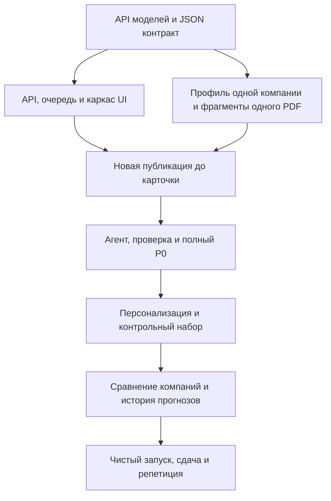

# План разработки Alphich на 72 часа

План рассчитан на пять участников. Все временные отметки — часы от старта разработки, а не календарный дедлайн. Если времени больше, добавляем проверку и резерв после рабочего P0. К десятому часу должен существовать один настоящий сквозной сценарий, к шестидесятому прекращаем добавлять функции.

Первый готовый компонент: [модуль подготовки компаний](data-pipeline.md). CLI проверен на полном наборе организаторов; доступны синтетический сценарий и тесты расчета признаков. Следующий потребитель — API профиля и механизм отбора событий.

Готова [подготовка экспертной базы](knowledge-base.md) в отдельном пакете `knowledge/`: распознаны все 64 страницы девяти PDF, подготовлены 149 поисковых фрагментов и 12 проверенных тезисов. Реестр различает старый и пересмотренный прогнозы, горизонт и автора.

Работает [локальный RAG retrieval](rag.md): E5 ONNX INT8, 158 векторов, lexical/dense/hybrid, scope по дате и документам, расширение parent и контекст с evidence IDs. На 17 открытых вопросах dense нашёл размеченную страницу в top-5 в 16 случаях, hybrid в 15, lexical в 12; десять контрольных случаев прошли во всех режимах. Backend подключает `BankRetriever` к индексу `data/processed/bank-index-v1`; API и LLM worker уже используют его в настоящем разборе.

Готов [модуль персонального отбора новостей](news-selection.md): до семи запросов компании, FTS/E5/RRF, основания с feature/fact IDs, фильтры доступа и времени, очередь извлечения и вопросы к банковскому RAG. CLI проходит путь «профиль → событие → банковский контекст» без генерации. На открытой вымышленной матрице 150 пар средний nDCG@5 — 0,9619 во всех режимах; преимущества E5 этот набор не показывает. Модуль подключён к LLM worker и API feed; реальные вызовы модели уже проверены, следующий рубеж — независимая разметка новых публикаций.

Реализован [LLM runtime и управляемая сеть v8](llm.md): `bank_researcher → analyst → verifier` с одним реестром доказательств, общими лимитами восьми вызовов/инструментов, кэшем, журналом и атомарным бюджетом. Исследователь уточняет поиск и передаёт ID актуальных проверенных тезисов; проверяющий может прочитать исходное evidence и вернуть замечания на одно исправление. Qwen извлекает цитаты, GLM выполняет генеративные роли; extractor v12 допускает одно исправление схемы либо атрибутов с независимой повторной проверкой. Дословный текст фактов подставляет сервер. Сохраняются исходные профиль, роль, дата и доступ вопроса.

Проверено: 169 автотестов backend/smoke; 24/24 новых синтетических контроля инфляции, валюты, ФРС и торговой пошлины на реальном шлюзе; отдельно — свежий разбор новости о ставке и вопрос. В положительных случаях получены 12 карточек с условными выводами, в зарубежных без экспозиции — 12 ограниченных результатов. Отчёты перепроверены без модели; это контроли разработки, не независимая оценка качества. Интерфейс подключает API ленты, карточек, вопросов, доказательств и журнала; есть [скрипт проверки стенда](integration-smoke.md). Для замены API подготовлен [расчёт локального сервера](local-inference.md): Qwen Q4, GPU 24/32 GB, предпочтительно 64 GB RAM; недельные GPU расходы превышают нулевой бюджет. Локальная генеративная модель не запускалась. Следующие шаги: независимая разметка и полный Docker/UI прогон. Полное извлечение длинных статей за пределами первого окна и загрузка payment features в API остаются расширениями.

## Распределение ответственности

| Направление | Ответственность | Первый результат |
| --- | --- | --- |
| A Интерфейс | Интернет-банк, лента, карточка, источники, вопрос, состояния | Экран работает по согласованному JSON |
| B Backend и интеграция | БД, API, сессия, очередь, кэш, Docker, общий контракт | API принимает публикацию и возвращает job |
| C Данные и источники | CSV ETL, расчет признаков, OCR, манифесты, RSS | Чистый профиль, новость и проверенные фрагменты PDF |
| D LLM и поиск | Адаптер API, retrieval, собственный агент, grounding, бюджет | Карточка с действительными evidence ID |
| E Качество и продукт | Контрольный набор, оценка релевантности, проверка источников, демо, документация | Размеченные примеры и сценарий проверки |

Если участников шесть и больше, выделяем отдельного разработчика на второй источник/ETL и отдельного на UI/визуализацию. Человек E помогает с ручной проверкой OCR с первых часов. Владелец B отвечает за регулярную интеграцию всех частей; каждый пишет проверку своей критичной логики.

## Порядок и зависимости

## Часы с 0 по 3

Вместе согласовать карточку, evidence и API из [контрактов](contracts.md). Проверить предоставленный ключ и endpoint: какие model ID реально доступны, протокол, JSON/tool calling, лимиты, тарифы и usage. Сделать короткий пробный extraction и analysis; записать задержку, токены и ошибки схемы.

Параллельно C и E подтверждают единицы выручки и выбирают три целевые компании; извлекают один проверенный фрагмент обзора ставки с датой и страницей. B поднимает PostgreSQL с pgvector, миграции и health endpoint. D закрепляет revision локального multilingual-e5-base и проверяет кодирование; A собирает основной экран по контракту и подключает API при его появлении.

Критерий: есть успешный реальный вызов разрешенной модели, пример валидной карточки, профиль и доказательство из PDF. Если шлюз недоступен, UI/ETL/API продолжаются на явно обозначенных fixtures; интеграция модели остается открытым обязательным пунктом.

B параллельно проверяет доступность стартового гранта Cloud.ru и полный estimate выбранной ВМ 4/16 по [плану размещения](hosting.md). До подтвержденного зачисления бонусов платные ресурсы не создаются. При отказе сразу готовим локальный стенд с tunnel; бесплатный маленький PaaS не подставляем без проверки памяти E5.

## Часы с 3 по 10

- A: выбор компании/роли, блок аналитики, лента и drawer карточки, переход к источнику.
- B: таблицы event/insight/job, создание задачи, worker и опрос статуса, идемпотентность.
- C: загрузка компании, один RSS и вставка текста; hash, нормализация, один индекс банка.
- D: извлечение фактов публикации, FTS baseline, первый E5/hybrid поиск, ограниченный агент, генерация JSON, серверная проверка. Сбой кодировщика не задерживает первый lexical сценарий.
- E: пять содержательных примеров, проверка всех ссылок первого результата, инструкция первого запуска.

Критерий: пользователь вставляет новый текст, выбирает одну компанию и получает свежесгенерированную персонализированную карточку с источниками. На источнике банка открывается нужная страница. Демонстрируемой генерации не предшествует ручная запись ответа в БД.

Если к десятому часу этот сценарий не работает, останавливаем расширение UI, графа и источников до его исправления.

## Часы с 10 по 24

Довести обязательный сценарий до трех компаний, двух ролей и 2–3 тем. Добавить вопрос по карточке с тем же контекстом доступа и доказательствами. Весь CSV импортируется воспроизводимо; готовые признаки исключают self-payments, отмечают неизвестных контрагентов и проблемы ФТС.

Проиндексировать первые релевантные обзоры, запустить OCR остального корпуса, проверять значимые фрагменты вручную. Встроить словарь тем/ОКВЭД, запросы компании по нескольким фасетам, FTS+E5 с RRF и причины попадания события в ленту. Для банка расширять найденные фрагменты до смысловых блоков и учитывать роль/горизонт прогноза. Привязать общую extraction к событию, а не повторять ее на каждого клиента.

Добавить атомарный учет бюджета, ограничение повторов, кэш с версиями и статусы сбоев. Подготовить реальный пример, где агент изменяет запрос после недостаточного или устаревшего результата поиска. Журнал доступен из карточки.

Критерий: полный P0 работает, а одно событие дает различимые, обоснованные результаты для разных компаний. После смены компании не остается чужой карточки или чата. Новая публикация и вопрос работают без заранее подготовленной генерации.

## Часы с 24 по 42

- Завершить индекс всех девяти PDF; 64 страницы обрабатываются пакетно один раз. Проверить даты, ключевые числа и все фрагменты, используемые в демо.
- Сравнить FTS, E5 и hybrid на одинаковом корпусе; отдельно оценить кандидатов новостей и правильные банковские страницы/утверждения. Увеличить разметку до 150–200 пар при доступности участника E. Добавить разнообразие ленты и подавление повторов одного события; протокол в [проекте поиска](retrieval.md).
- Подключить второй источник, проверить получение текста, даты, дубликаты и ограниченность RSS истории.
- Добавить прямые платежные признаки с показателем охвата. Инструменты получают готовые top-N связи, а не пересчитывают весь граф на запрос.
- Проверить права, prompt injection в источниках, лимиты URL загрузчика, бюджет и восстановление после сбоя worker.
- Завершить развертывание на выбранной Cloud.ru ВМ, проверить тот же Docker запуск на втором компьютере, внешнюю сеть и 3–5 одновременных демопользователей. Контролировать расход гранта; при его недоступности использовать заранее подготовленный локальный резерв.

Критерий: двадцать и более размеченных пар «событие — компания», источники открываются, ошибочные тезисы не маскируются ссылками, модель и стоимость измеряются.

## Часы с 42 по 54

Сделать две сильные демонстрационные функции в порядке приоритета:

1. Сравнение одной новости для двух компаний: разные продукты/отрасли, разные последствия, видимые причины различия.
2. История позиции банка: прогноз от 31 июля и обновление от 11 сентября, приоритет последнего применимого обзора, страницы обоих источников.

Если обе функции готовы и контрольный набор проходит, добавить компактный обзор группы и обратную связь. Для группы показывать состав, покрытие данных и внутригрупповые связи; сумму выручки не представлять как консолидированный показатель.

Критерий: каждая новая функция усиливает основной пользовательский сценарий и работает на актуальных данных приложения. Сложный финансовый калькулятор и многошаговые цепочки контрагентов откладываются.

## Часы с 54 по 60

Прогнать 25–30 размеченных пар на финальной конфигурации. Сохранить результаты, время, стоимость и ошибки по версиям модели/prompt/данных. Исправить провалы, затем прекратить добавление функций. Подготовить скриншоты и короткую резервную запись реального сквозного запуска с датой.

## Часы с 60 по 72

Проверить запуск с чистой БД и по README, включая импорт разрешенных данных и синтетический сценарий. Воспроизводимость не должна зависеть от локального кэша разработчика. Пройти живую новую публикацию на финальном стенде и сохранить резерв бюджета.

Зафиксировать зависимости, сторонние компоненты и смоделированные интеграции. Проверить GitHub доступ жюри, документировать текущий commit hash/tag на дедлайн и завершить загрузку до него. Подготовить презентацию, репетицию и резерв на сетевые сбои. Время с 66 по 72 оставляем преимущественно под исправления и репетицию.

## Проверки качества

Пороговые значения ниже — стартовые цели команды, а не заявленные результаты. После первых примеров зафиксировать их до финального прогона.

| Проверка | Критерий |
| --- | --- |
| Релевантность | Precision@5 по экспертной разметке; начальная цель не ниже 0,8, показывать размер выборки |
| Источники | Каждый существенный факт и позиция банка имеют проверенное evidence; отдельно оценивать смысловую поддержку |
| Атрибуция | Ни одна интерпретация AI не названа мнением банка без материала |
| Время | Нет обзоров из будущего относительно as_of; неизвестная дата не подменена датой файла |
| Числа | Проценты рассчитаны кодом, знаменатели и охват доступны; self-payments исключены |
| Агент | Хотя бы один условный повторный поиск реально происходит и меняет результат/ограничения |
| Новизна | Ранее не показанная публикация проходит полный сценарий |
| Доступ | Смена ID в API не открывает чужой профиль, job, evidence или чат |
| Отказ модели | Понятный статус, нет бесконечного retry и подмены новой генерации кэшем |
| Бюджет | Измеренная стоимость, атомарный резерв, общий дневной лимит и запас для демо |
| Производительность | На измеренном стенде зафиксированы p50/p95; ориентир: кэш до 1 с, новая карточка до 60 с |

Контрольные случаи: нерелевантная новость, дубликат, новый факт в старом событии, противоречащие обзоры, старая аналитика 2021 года, неизвестные условия кредита, неизвестный контрагент, отсутствие банковской оценки, неполный текст, поврежденное число OCR, попытка инструкции внутри новости, неверный evidence ID, отказ API и превышение бюджета.

Для персонализации сравнивать совпадение текста недостаточно: эксперт должен отметить, какой клиентский признак объясняет каждое различие. Для мониторинга сохранять оценки пользователей и экспертные ошибки с версией карточки; изменения модели и правил прогонять на том же наборе.

## Сценарий защиты на пять минут

1. 0:00–0:40 — компания целевого масштаба, роль, блок на главной, причины отбора.
2. 0:40–1:40 — событие, влияние, позиция банка с датой, интерпретация AI, открытие страницы источника.
3. 1:40–2:20 — другая компания и изменение порядка/объяснения того же события.
4. 2:20–3:10 — новая публикация запускает живой анализ; пока он выполняется, показать смену прогноза банка.
5. 3:10–4:20 — результат новой публикации, уточняющий вопрос, ограничение при неизвестных условиях.
6. 4:20–5:00 — журнал инструментов, качество, стоимость и воспроизводимость запуска.

Исторический анализ подписан датой, синтетические профили явно обозначены. Живой сценарий сохраняет смысл при отсутствии подходящей оценки банка: он показывает найденные факты и ограничения, а не выдумывает банковскую позицию.

## Комплект сдачи

- GitHub с историей коммитов и однозначной финальной версией; для приватного репозитория доступ `alfa-hack-2026`.
- README: назначение, архитектура, окружение, конфигурация, запуск, импорт, синтетические аккаунты и пошаговая проверка.
- Docker Compose и фиксированные версии языка/зависимостей; миграции и health checks.
- `THIRD_PARTY_NOTICES`: библиотеки, OCR/языковые данные, модели, источники, датасеты, сервисы и смоделированные интеграции.
- Синтетические данные, достаточные для сквозного теста; исходные файлы организаторов и ключи не коммитить автоматически.
- Архитектура, OpenAPI, результаты оценки и короткий сценарий защиты.

## Что уточнить в первые часы

Точный дедлайн и формат защиты; API/тарифы разрешенных генеративных моделей; единицы и дата выручки; единицы/период платежного среза; правила повторяющихся платежных пар; смысл `NEGATIVEMARK`; доступность внешних источников и характеристики стенда. Локальные embeddings уже разрешены уточнением пользователя. Открытые вопросы не останавливают UI, контракты, ETL и поиск по проверенным фрагментам.
