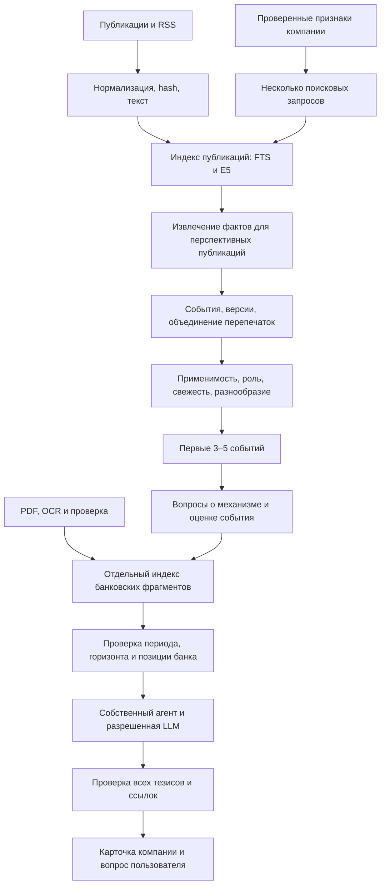

# Отбор новостей и поиск аналитики Alphich

Уточнение условий от пользователя 20 октября 2026 года: локальные embedding-модели, включая multilingual-e5, разрешены; список ограничивает генеративные LLM. Основной вариант поиска теперь гибридный: PostgreSQL FTS и локальные эмбеддинги, объединенные по рангам.

В продукте две отдельные задачи: найти события, важные компании, и найти доказательства для интерпретации выбранного события. У них разные запросы, фильтры и метрики качества. Наличие банковского материала не является условием допуска новости в ленту.

## Полный путь данных

Публикации индексируются без генеративного вызова на каждую компанию. В первую очередь разбираем материалы, попавшие в объединенный пул кандидатов активных компаний, и существенные общие события. После извлечения фактов повторно проверяем применимость и кластер события. Извлечение выполняется один раз на версию материала, а не на каждую пару «компания — новость».

## Локальная модель и хранение

Начальный вариант — `intfloat/multilingual-e5-base`; small остается вариантом для слабого CPU после измерения качества и времени. Large не включаем в P0 без выигрыша на нашем наборе. Производительность и RAM до прогона на целевом стенде неизвестны.

У base размерность 768, предел входа 512 токенов. Для поиска используем `query: ` у запроса и `passage: ` у документа, включая русский текст; векторы нормализуем. Для симметричного сравнения публикаций нужен отдельный режим `query: ` с обеих сторон. Косинусное сходство не является вероятностью: высокий фон оценок ожидаем, пороги нельзя читать как проценты уверенности. [Авторская карточка E5](https://huggingface.co/intfloat/multilingual-e5-base).

Префикс задается ровно один раз. Нельзя рассчитывать, что библиотечный метод сам выберет нужный prompt без настройки. Проверяем фактический вход токенизатором; в предел входят заголовок, метаданные и префикс. Длинный текст делим до кодирования, а не молча обрезаем. [API SentenceTransformers](https://sbert.net/docs/package_reference/sentence_transformer/model.html).

В PostgreSQL добавляем pgvector, для base — `vector(768)`. Сначала точный поиск ближайших соседей по доступным записям. HNSW/IVFFlat добавляем после измеренного роста задержки; они меняют полноту поиска и требуют отдельной оценки. Точный поиск по вектору не гарантирует смысловую правильность результата. [Документация pgvector](https://github.com/pgvector/pgvector#indexing).

Embedding space фиксирует model ID, commit модели/tokenizer, размерность, нормализацию, pooling, режим префикса, версии предобработки и chunker. Запись привязана к неизменяемому источнику, версии OCR и hash реально закодированного текста. Разные пространства не смешиваются; переход на small требует нового пространства и соответствующей размерности хранения. Переключение версии выполняется после построения нового индекса.

Модель загружается один раз в выделенном worker процесса, кодирование пакетное. Для запросов компании кэшируем векторы по версии признаков, роли, шаблона и пространства. Сырые 1,38 млн платежных строк не эмбеддим: для них нужны SQL агрегаты.

## Запросы компании

Вместо одного длинного текста со всеми полями создаем до 5–7 ограниченных фасетов. У каждого есть ID, текст запроса и исходные feature ID.

| Фасет | Пример интереса | Основание и предел |
| --- | --- | --- |
| Отрасль | Электрооборудование, промышленное производство, регулирование сектора | ОКВЭД и проверенный словарь синонимов; конкретное сырье без данных остается гипотезой |
| Финансирование | Стоимость заимствования или размещения средств | Положительные признаки кредита, лизинга или депозита; условия и остатки неизвестны |
| Внешняя торговля | Торговые правила и логистика для отрасли и указанных стран | ФТС; произвольная политическая новость о стране не считается прямой связью |
| Регион | Регулирование и инфраструктура региона | Регион регистрации, а не доказанная география всех операций |
| Связи | Изменения в известных отраслях платежных соседей | Один переход, доля потока и охват профилями; хозяйственный смысл связи неизвестен |
| Роль | Казначейство и финансирование либо спрос и стратегия | Настройка интереса человека; роль не добавляет фактов о компании |

Отсутствующий продукт не включаем в семантический запрос фразой «кредита нет»: само слово может привлекать кредитные новости. Ограничиваем число стран и соседних отраслей, а не создаем десятки равноправных каналов. Макроэкономический контекст остается доступен компании и без банковских продуктов.

## Кандидаты и ранжирование новостей

Для каждого фасета получаем, например, FTS top-15 и dense top-15. Объединяем ранги через RRF; результаты нескольких фрагментов одной публикации/события сначала сворачиваем в одну запись. Между фасетами используем максимум либо ограниченную сумму, чтобы длинный профиль не получал преимущество от числа запросов.

Права и дата анализа ограничивают обе выдачи до top-K. Для исторической ленты подходят только публикации и версии фактов, доступные к `as_of`; поздние дополнения к старому событию исключаются. Нельзя передать агенту нынешнюю сводку кластера только потому, что первая новость в нем старая. Используем допустимый снимок либо собираем его из допустимых свидетельств. Дата будущего вступления правила в силу не исключает уже опубликованную новость об этом правиле.

RRF складывает `weight / (k + rank)` по спискам; отсутствующий элемент дает ноль. Начально можно взять `k=60`, но это настройка, а не измеренный оптимум. Складывать `ts_rank` и cosine напрямую нельзя: у них разные шкалы. PostgreSQL FTS с `ts_rank` не называем BM25. [Гибридный поиск pgvector](https://github.com/pgvector/pgvector#hybrid-search).

Отдельные каналы добавляют структурные совпадения и важные общие события: решение ЦБ, регулирование широкого действия, существенную макростатистику. Общий пул ограничиваем примерно 50–80 уникальными кандидатами; эти числа настраиваем по разметке. Совпадения темы недостаточно, чтобы назвать событие значимым для всех.

Далее обычный код оценивает применимость, ранг поиска, значимость события, свежесть и интерес роли. Для свежести учитываем тип события: закон может действовать дольше краткого рыночного сообщения; перепечатка не обновляет возраст исходного события.

Уровни связи:

- `direct` — факт события сопоставлен с подтвержденным признаком компании; это тематическая применимость, а не доказательство денежного ущерба.
- `context` — отраслевой или общий контекст.
- `hypothesis` — смысловая связь требует дополнительных данных.

Ранжирование сохраняет reason codes, matched feature IDs и fact IDs. Модель не придумывает задним числом причину попадания в ленту. Смысловое сходство само по себе не становится доказательством.

Графовый вклад ограничиваем. Если отраслевую долю уже посчитали от всего потока, включая неизвестных контрагентов, повторно умножать ее на coverage не нужно. Охват показываем отдельно; неизвестное не становится нулевой экспозицией.

В первых пяти карточках обычно не больше двух по одной теме и одна на одно событие. Это мягкие ограничения: крупное событие не теряется ради разнообразия, а нерелевантную карточку не добавляем ради заполнения экрана. Достаточно трех хороших событий.

## Объединение публикаций

URL и content hash устраняют точные перепечатки. Симметричные embeddings предлагают похожие материалы, но не принимают решение об их объединении. Проверяем участников, тип события, даты, действие и существенные числа.

Разные заседания ЦБ, прогноз и состоявшееся решение, отмена и введение правила, одинаковые меры разных стран — разные события либо явно связанные версии. Перепечатки одного агентского сообщения не считаем независимыми подтверждениями. Сохраняем исходные публикации и версии; новые факты инвалидируют связанные карточки.

## Поиск банковских доказательств

Из выбранного события и подтвержденной связи с компанией строим отдельные вопросы: какой механизм влияния описан, какой показатель важен, какова последняя найденная оценка в корпусе, на какой горизонт. Вопрос пользователя добавляется к этому контексту, а не заменяет профиль и событие.

Порядок:

1. Проверить права и дату анализа; для исторического режима применить временной фильтр до формирования обоих top-K списков.
2. FTS top-10 и dense top-10 по банковскому корпусу, RRF и удаление перекрывающихся результатов.
3. Проверить тему, географию, показатель, сценарий и горизонт. Отдельно искать прогноз и объяснение механизма.
4. Подтянуть связанные обновления/предыдущие позиции по реестру утверждений, даже если они не вошли в top-K.
5. Расширить найденный фрагмент до смыслового блока, сохранив условия, отрицания и даты.
6. Передать генеративной модели небольшой набор пригодных доказательств; при недостатке изменить запрос один раз в пределах бюджета.

`as_of` и доступ фиксируются в исходной задаче сервером. Те же фильтры действуют при обходе `revision_of`, расширении parent и повторном поиске; аргумент модели не может расширить временную границу. Неизвестная дата доступности версии источника не дает основания использовать ее в строгом историческом режиме.

Начальная нарезка — 200–350 токенов содержимого E5, overlap примерно одно предложение. Заголовок и дата добавляются компактно. Ищем по небольшому child, а для интерпретации подтягиваем parent из связанных абзацев. Расширенный блок может быть длиннее лимита E5, поскольку повторно не кодируется; контекст генерации ограничивается токенизатором выбранной LLM.

Citation указывает на точную выдержку и страницу внутри parent, а не на произвольный большой блок. Если подтверждение найдено в соседнем span вне первоначального child, сервер выдает отдельный неизменяемый evidence ID для использованного span; ссылка на child остается поисковым совпадением. При переходе через страницу сохраняем все исходные span. Числа из таблиц/графиков используются после проверки по изображению. Контакты и служебные страницы исключаем из содержательного поиска.

## Банковская позиция на уровне утверждения

Минимальный `bank_claim`: источник и блок, тип (`observation`, `interpretation`, `forecast`, `mechanism`), автор утверждения (`attributed_to`), показатель, единица, география, сценарий, период наблюдения, прогнозный горизонт, роль позиции и `revision_of`. Цитата ЦБ или статистика Росстата внутри банковского PDF остается атрибутированной исходному автору; она не становится экспертным мнением банка только из-за места публикации.

Роли: `current_in_document`, `previous_view`, `conditional`. Первая означает позицию на дату документа. Она не доказывает актуальность для всего банка на сегодняшний день.

В обзоре 11 сентября на одной странице встречаются: прежние 13,5% на конец 2026, обновленные 14% на конец 2026 и 12% на конец 2027. Для выбора нужны роль и горизонт. Более свежая дата PDF не устраняет неоднозначность. [Обзор ставки](https://drive.google.com/file/d/1shHG89LtMgHT1_uEebHmQSFZe_zbeq7-/view).

Для девяти документов достаточно проверить вручную небольшой реестр ключевых прогнозов и связей обновления. Это разметка исходного знания; новые события и персональные выводы обрабатываются общим алгоритмом. Обработка нового документа предусматривает автоматическое извлечение с последующей проверкой.

В текущей ленте пишем «В предоставленном обзоре от …» или «Последняя найденная оценка в загруженном корпусе …». Для неизвестной даты публикации не подставляем месяц обложки. Исторический прогноз не отменяет наблюдавшийся факт; новый прогноз с другим горизонтом не заменяет нужный.

## Что получает агент

Пакет включает выбранное событие и его факты; профиль и matched feature IDs; ограниченные платежные агрегаты; банковские фрагменты с датами и горизонтом; недостающие данные; trace поиска. Если банковской позиции нет, это отдельный статус, а не повод отбрасывать событие или придумывать мнение банка.

Агент уточняет поиск и формирует связанный анализ. Ответ различает факты, позицию банка и условные выводы. Проверка доказательств остается обязательным серверным этапом. Отдельный cross-encoder и дополнительный LLM rerank не требуются для P0; их имеет смысл добавлять только после измеренного выигрыша с учетом задержки и бюджета.

## Кэш и воспроизводимость

Сохраняем версии корпуса, OCR, извлеченных событий, embedding space, шаблонов запросов, словаря и ранжирования. В журнале: facet/query, фильтры, lexical/dense/fusion rank, причины исключения по времени, parent IDs, выбранные bank claims и evidence IDs. Итоговый кэш анализа учитывает эти версии.

Сбой кодировщика переводит поиск в явно отмеченный lexical режим. Его результат не записываем под ключом гибридного результата. Веса модели заранее загружаются и закрепляются по revision; исходный запуск по README предусматривает получение весов и проверку доступности. Генерации ключом организаторов для локального кодирования не нужны, но CPU/RAM и время измеряются отдельно.

## Проверка качества и настройки

Сравнить на одном корпусе и одинаковом структурном ранжировании: FTS; E5; hybrid. Дополнительно сравнить единый текст профиля с несколькими фасетами. Тестовые события группировать при разделении на development/holdout, чтобы перепечатка не оказалась по другую сторону разделения.

| Контур | Минимальная проверка | Метрики |
| --- | --- | --- |
| Новости | 30–40 разных событий и пять компаний; полная матрица 150–200 оценок 0–3 | Recall кандидатов, nDCG@5, нерелевантные карточки, повторы, покрытие важных общих событий |
| Банк | 20–30 запросов с допустимыми страницами/тезисами и случаями без ответа | Recall@10, попадание нужного утверждения, ошибки времени и горизонта, корректный отказ |
| Система | Одинаковый стенд, новая публикация и вопрос | p50/p95, RAM, время индексации, стоимость генерации и кэш hit rate |

Часть разметки проверяет второй участник. Это план эксперимента; измеренных результатов и доказанного преимущества hybrid пока нет.

Обязательные проверки:

- Ставка: кредитный и депозитный клиенты релевантны по разным основаниям; отсутствие кредита не исключает макроконтекст.
- Китай: наличие страны ФТС не делает любую новость о Китае важной.
- Золото: слово «металл» не доказывает влияние на производителя металлоконструкций.
- Прогноз на конец 2026 известный на 1 августа: только источники, доступные к этой дате.
- Прогноз на конец 2026 после 11 сентября: не взять прежние 13,5% или прогноз 12% на 2027 год.
- Сталь 2021: не выдать краткосрочный прогноз за октябрь 2026; механизм можно рассматривать отдельно.
- Обзор золота с неизвестной датой: исключить из строгого исторического режима.
- Новое событие без PDF банка: сформировать ограниченный анализ с источниками новости и клиента.
- Почти одинаковые новости с разными датами решения: не объединить только по cosine.

## Очередность реализации

1. OCR и проверенные страницы; FTS baseline; профили и несколько запросов компании.
2. Один локальный E5 worker, pgvector exact, пространства и пакетная индексация.
3. Гибридный поиск кандидатов, структурный ranking и разнообразие ленты.
4. Банковский hybrid RAG с датами, parent expansion и реестром ключевых прогнозов.
5. Агент, доказательства, кэш и сравнение трех поисковых вариантов.

Первые 1–2 шага идут параллельно UI/API и не задерживают сквозной рубеж к десятому часу: lexical путь остается полноценным промежуточным режимом. Расширение моделей и ANN имеет смысл после подтвержденного узкого места.
